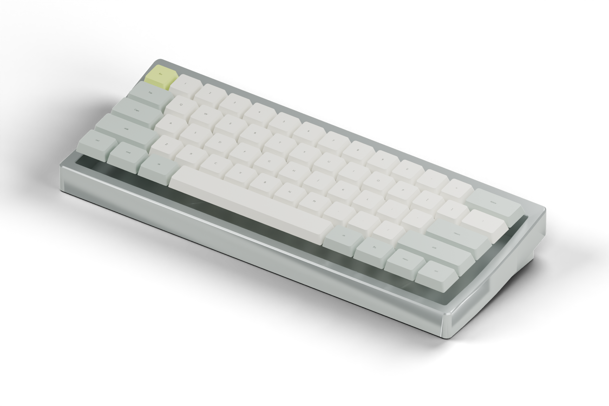

# Unextended EC 无线静电容开发

基于 [4pplet/Unextended](https://github.com/4pplet/Unextended) 的 V1 外壳，新增 NIZ 静电容方案。上游 ALPS 设计与原始历史保留在 [README](README.md)，许可与来源见 [NOTICE](NOTICE-WIRELESS-EC.md) 和 [原许可](LICENCE.md)。本分支不代表上游或 NIZ 官方产品。

目标为 ANSI 61 键、6.25U 空格、MX 十字轴键帽，使用 ZMK、BLE + USB。当前 [A2 方案](docs/direct-usb-A2.zh-CN.md) 将 nice!nano v2 固定在低位接口仓，原生 Type-C 直接对外；不在空格下叠放主控、不使用 USB 延长线。高阻前端留在感应板，内部 FFC 只传 GPIO、供电和缓冲 ADC。需要内部改版 V1 外壳。

**当前是工程开发版，不可直接用于生产。** 两块板完成布线，原生 DRC 为零错误、零未连接；仍有库/丝印警告，装壳、实物 EC 扫描、蓝牙干扰、充电和续航均未完成验证。普通/校准 UF2 已本地编译，真实驱动函数完成 960 组模拟时序及 61 键按下/释放回归，不能等同于整机实测。

- [完整工程说明](docs/direct-usb-A2.zh-CN.md)：直出 USB、接口仓、模拟隔离、固件及放行边界。
- [焊接、分阶段上电与校准](docs/direct-usb-A2.zh-CN.md#焊接与分阶段检查)：按两块板的 BOM 检查。
- [渲染与可复现说明](docs/renders.md)：真实 V1 CAD 与参数化键帽包络，不是装壳验证。
- [中英双语宣传站](website/README.md)：有工程状态说明，不包含购买入口。

源文件：`hardware/` KiCad（主板及接口载板）、`mechanical/` STEP/DXF、`firmware/` ZMK/UF2、`design/` 参数及针脚、`reports/` 验证证据。A0/A1 文件说明为历史记录，不能指导 A2 装配。
