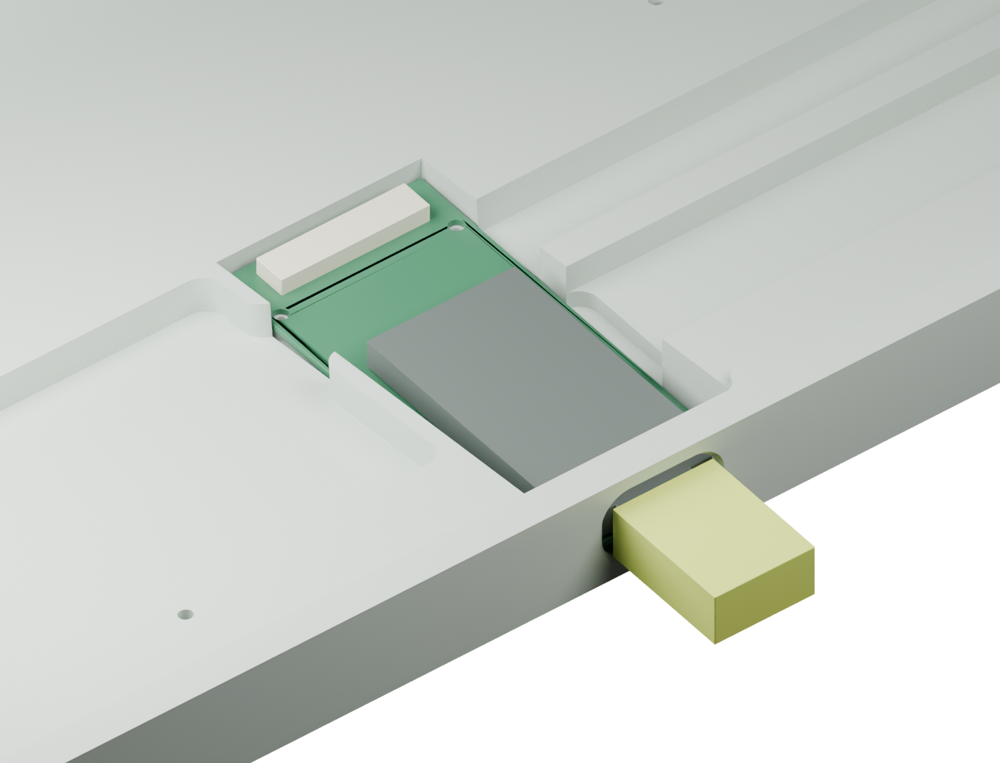

# A2: native USB-C at the case opening

[简体中文](direct-usb-A2.zh-CN.md) · [Main schematic](../hardware/UnextendedEC-schematic.pdf) · [Carrier schematic](../hardware/UnextendedEC-controller-schematic.pdf)

A2 supersedes A0/A1. The nice!nano is **not on the sensing PCB beneath the spacebar**. A 24 × 52 × 0.8 mm carrier holds it in the low USB bay. The external cable plugs directly into the module's original USB-C socket: no internal USB extension, no C3 daughterboard, no socket modification. BLE + USB, ANSI 61, 6.25u spacebar and firmware GPIO assignments remain unchanged.

**Development design, not fabrication approval.** Software, geometry envelopes and DRC cannot establish zero electrical impact. Physical EC-noise, charging, RF and scan-stability tests remain mandatory.

## Mechanical changes

`generate_usb_bay.py` extracts the actual V1 USB opening's inner contour from the reference STEP. Its center is approximately `(0, 50.442, 6.9545)` mm in the case coordinate system. The nominal module mouth aligns there, facing out the back. The module envelope uses footprint dimensions and the manufacturer's 3.2 mm total thickness, not a vendor STEP; actual socket offset and tolerances still require measurement.

The carrier/module interfered with the **unmodified** case. Use the internally revised `Unextended_V1_EC_direct_USB.step`, not the original case unchanged. It preserves the external opening, locally widens/extends the internal pocket and adds supports. `direct-usb-assembly.step` records nominal placement. The report checks case overlap for the carrier, module, FFC connector, capacitor and a 12 × 6 mm external plug envelope.

Four 1.6 mm carrier holes accept a candidate M1.4 plastic-thread-forming screw arrangement with head diameter at most 2.5 mm. Pilot size, length, retention and insertion loads need prototyping. Pocket floor minimum z is 2.8 mm. Do not substitute thick tape/foam for mechanical USB support.

The RF baseline is non-metallized polycarbonate. Aluminum needs a separate RF-window design; foil is not a substitute. Carrier RF keepout `(6,26)–(18,44)` mm prohibits all-layer copper, vias and routing. Do not add a metal shield, conductive foam or battery over it. Final sensing-stack height and separation remain unqualified.

## Electrical separation

`EC electrodes → U2/U3 mux → local U4 amplifier → R37 → J2 cable → C6 → nano ADC`

High-impedance SENSE and feedback remain on the sensing PCB. U4 is closer to the muxes; its feedback uses AMP_OUT **before** the 47 Ω output-isolation resistor R37. The carrier's C6 is 1 nF C0G/NP0 from ADC to GND. Stability, cable load and sampling settling must be checked with an oscilloscope, not inferred from the nominal RC.

J2 is 24-position, 0.5 mm FH12. ADC pin20 is flanked by GND pins19/21. It carries no USB D+/D−, VBUS or high-impedance SENSE. Use a continuity-verified pin1-to-pin1 cable; contact face/orientation must not be guessed. The candidate 50 mm length and fold path are not tolerance-qualified.

| Pins | Signal | Pins | Signal |
| --- | --- | --- | --- |
| 1/2/4/10/16/19/21/24 | GND | 3 | VCC |
| 5–9 | ROW_DRV0–4 | 11/12/13 | MUX_A/B/C |
| 14/15 | MUX0_INH / MUX1_INH | 17/18 | DRAIN / AFE_ON_N |
| 20 | Buffered ADC | 22/23 | BAT_SW / RESET |

See `design/interconnect-map.csv` and `pin-map.csv`; native schematic/PCB net parity is checked by `verify_design.py`. USB CC/data/ESD and charger remain on the genuine module. Never inject USB 5 V into J2 or BAT_SW.

## Soldering and staged checks

1. Disconnect all power. Sort both BOMs; solder mainboard passives, then U2/U3/U4/Q1. R37 is on the mainboard; C6 is on the carrier. U4 pin6 is AMP_OUT. Do not confuse C4=220 pF with C6=1 nF.
2. Main J2 is on B. Carrier U1/J2 are on F; C6 is on B. Verify the module's 270° orientation and socket facing the external opening against native pads and the actual module, not A1's layout.
3. Fit J1, SW1 battery harness and SW2 reset harness; no cell yet. Check module USB/flashing independently, then attach a pin-by-pin verified cable.
4. With no battery, use current-limited/monitored USB and inspect nominal 3.3 V VCC, switched AFE supply, ground and heat. Disconnect on sustained limiting; do not force operation by increasing the limit.
5. Flash the calibrator. Scope AMP_OUT and ADC; verify settling, no saturation and only one MUX enabled at a time. Record raw ADC/noise under USB, active BLE and charging **before** threshold tuning.
6. Verify the protected single-cell battery polarity. Its path is `J1.1 → SW1 → J2.22 → U1.24`, with negative to GND. Test battery boot and charging. Retain the module's default low-current charge setting; fast charge is not qualified for this cable/contact/cell combination.
7. NIZ housings, domes and springs are mechanically retained; **never solder cone springs to electrodes**. Qualify the coupon, clips, stabilizers and travel first. The 1.6 mm PCB/plate and 6 mm spacing remain candidates.
8. USB shell: `ec kscan0 calibration start`, follow released/all-61-key prompts, then `ec kscan0 calibration export` and `ec kscan0 calibration save`. Retain export, power-cycle to verify persistence, then flash normal firmware without erasing settings.

Test every press/release/hold, simultaneous keys, idle first taps, USB/BLE switching/reconnects, low battery and charging. Repeat with final case, stabilizers, wiring and battery. Only measurements can establish no observable electrical regression.

## Reproduction and boundaries

Python: schematic/firmware generators. KiCad 10 Python: PCB generators and net checks for both boards. `generate_pcb.py` refuses to overwrite a routed PCB unless `--overwrite-routed` is explicitly supplied; regenerate only in a disposable checkout. For the mainboard, then run `prepare_routing.py` and `import_routing.py UnextendedEC --proxy --session UnextendedEC` to produce `UnextendedEC-routed-candidate.kicad_pcb`. For the carrier use `import_routing.py UnextendedEC-controller`. Retained `.ses` files restore named-net routing without replacing native placements; rerun native DRC before accepting either result. CadQuery: `generate_mechanical.py` and `generate_usb_bay.py`; Blender: `render_usb_bay.py`. Firmware retains the pinned manifests, original GPIO mapping and both built UF2 images; mocked regression is not physical qualification.

Sources: [module specification](https://nicekeyboards.com/nice-nano/), [pinout](https://nicekeyboards.com/docs/nice-nano/pinout-schematic/), [OPA350](https://www.ti.com/lit/ds/symlink/opa350.pdf). No approved complete-keyboard manufacturing package is released.
