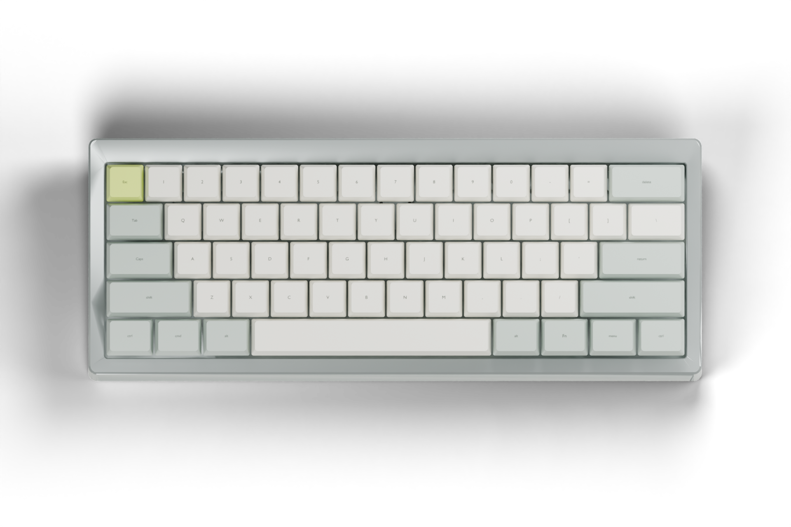

# Render notes / 渲染说明

Current A2 internal engineering cutaway / 当前 A2 接口仓剖视：


The cutaway uses the revised real V1 case and nominal carrier/module/plug envelopes. The nano is in the low USB bay, not beneath the spacebar on the sensing PCB. Reproduce with `generate_usb_bay.py` and Blender `render_usb_bay.py`. It is not a vendor module model or physical fit/EMI approval. / 此图使用改版真实 V1 外壳，载板/模块/插头为名义尺寸包络；不代表实物装配或电气验证。




These are Blender studio renders, not AI-generated product photographs. The case mesh comes from the actual upstream V1 STEP. Keycap envelopes/legends are parametrically generated for the chosen ANSI 61 layout. Finish, cap profile, colors, plate height and case-to-key alignment are appearance studies, not physical fit evidence. The images do not show validated internal electronics or represent an assembled prototype. Silver is a finish study, not an aluminum-case BLE performance claim.

以上为 Blender 渲染，不是实物照片。外壳网格来自上游真实 V1 STEP；键帽包络与字符按 ANSI 61 配列参数化生成。表面、颜色、键帽型面、板间距和外壳对齐均属外观概念，不能代替装壳验证。图片不代表已装成的整机，也不展示已验证的内部电路。银色仅为外观研究，不承诺全铝壳蓝牙表现。

Reproduce / 复现：

```
python scripts/export_render_geometry.py
blender --background --python scripts/render_blender.py
```

The first command needs `requirements-cad.txt`; Blender 4.5 was used. `renders/unextended-concept.blend` retains the scene. The V1 source and licence attribution are in [NOTICE](../NOTICE-WIRELESS-EC.md).
