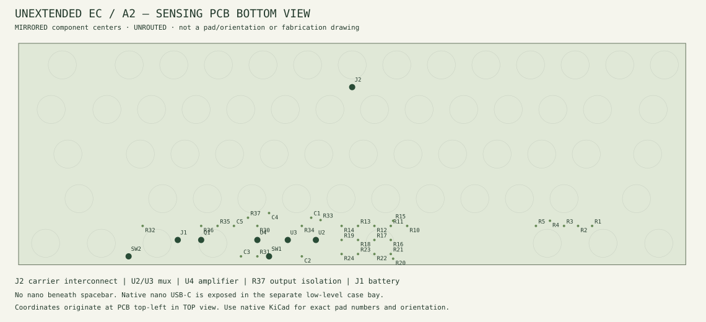

# Unextended EC 焊接与分阶段上电指南

> **历史 A1 指南，不能用于 A2。当前请使用 [A2 焊接与分阶段检查](direct-usb-A2.zh-CN.md#焊接与分阶段检查)，不要按下文安装空格下主控。**

[English](soldering.md) · [工程说明](wireless-niz.zh-CN.md) · [装配位置图](../renders/assembly-bottom.svg)

适用：当前 A1 一体式 nice!nano v2 主板。**主板尚未完成布线，也未通过生产放行；本指南是首件流程草案，不是现在即可下单、焊接的成品套件说明。** 先完成原生 DRC 零错误、零未连接、装壳净空和元件复核，再制作电路首件。独立 `-controller` 文件不是本装配的一部分，不要购买 FFC。

## 1. 开始前

准备温控烙铁、适合 0805/SOIC 的烙铁头、细焊锡、电子用助焊剂、镊子、放大镜、万用表、带限流/电流观察的 USB 供电设备；调试模拟信号还需要示波器。不要在带电或连接电池时焊接。焊接参数遵循实际焊料、元件和 PCB 工艺，不以一个温度适配全部器件。

按 [`hardware/BOM.csv`](../hardware/BOM.csv) 点料。B 面是元件面，F 面是电极/弹簧面。下方图为**从底部观察的镜像布局示意**，只标元件中心与功能区；焊盘号和方向以原生 KiCad PCB、原理图和器件数据手册共同核对。

| 焊接批次 | 位号 | 标称值 / 注意事项 |
| --- | --- | --- |
| 行驱动 | R1–R5 | 100 Ω，勿误用 100 kΩ |
| 列泄放 | R10–R24 | 100 kΩ |
| 模拟反馈/泄放 | R30=100 kΩ；R31、R32=1 kΩ | 闭环非反相增益候选为 101；不是实测信号增益 |
| 启动状态/电源门控 | R33–R35=100 kΩ；R36=1 kΩ | 检查网络，勿省略上拉 |
| 去耦 | C1–C3=100 nF；C5=1 µF | 按实际电源电压选额定值；图中均为非极性陶瓷 |
| 采样电容 | C4=220 pF C0G/NP0 | **不是 220 nF**；数值仍须首件调整 |
| 模拟 IC | U2/U3=CD74HC4051M96；U4=OPA350UA | 不要以 HCT、OPA2350 或其他同封装型号盲换 |
| 门控 MOSFET | Q1=AO3401A，P 沟道 SOT-23 | 1=G、2=S、3=D；采购后再次核实厂商资料 |
| 接口 | J1=JST PH2；SW1 电池开关；SW2 常开复位 | SW1/SW2 是 2.54 mm 焊线孔，不是某款滑动开关的专用封装 |
| 控制器 | U1=原版 nice!nano v2 | 安装在主板背面；模块、焊脚和 USB 插头高度尚待装壳确认 |

## 2. 焊接电子部分

1. 检查裸板无断铜、翘曲、划伤、孔毛刺。核对四层板叠层及阻焊：电极必须保持设计表面，不可自行镀锡、打磨或贴铜。先测电源与地之间是否存在明显短路。
2. 先焊 0805 阻容。每组焊后核对标称值、位号和桥连。SENSE 高阻节点周围不要残留助焊剂或金属屑。
3. 焊 U2/U3、U4、Q1，先固定一脚，确认方向和对齐后再焊其余引脚。U2/U3 的 16 脚为 VCC，7/8 脚为 GND；U4 的 7 脚为 AFE_3V3、4 脚 GND、3 脚 SENSE、6 脚 ADC。底面视图与数据手册顶视图相反，不能照着纸面左右直接装。
4. 焊 J1 和 SW1/SW2 的短线束，做好绝缘和应力释放。SW1 串在电池正极路径；SW2 只短接 RESET 与 GND。禁止将 RESET 当电源开关。暂不接电池。
5. U1 先不焊死。逐个核对实际模块焊盘：PCB 21=VCC、23=GND、24=BAT_SW、22=RESET、18=D19/P0.02；这是本工程物理焊盘编号，不是 nRF52840 芯片脚号。先检查模块独立 USB 枚举/刷写，再按照原生 PCB 方向安装。是否使用排针或低矮插座要由装壳高度决定，当前没有已放行的插座高度。
6. 清洁 PCB 焊接区并彻底干燥，检查焊锡球、虚焊和桥连。清洁剂不要接触 NIZ 轴体、橡胶碗、润滑材料或电池。

参考厂商资料：[nice!nano 安装](https://nicekeyboards.com/docs/nice-nano/getting-started/)、[引脚](https://nicekeyboards.com/docs/nice-nano/pinout-schematic/)、[TI CD74HC4051](https://www.ti.com/lit/gpn/CD74HC4051)、[TI OPA350](https://www.ti.com/lit/ds/symlink/opa350.pdf)。焊接前按采购的精确料号/封装再次确认。

## 3. 分阶段通电检查

电源连接关系：`J1.1 BAT_RAW → SW1 → BAT_SW → U1.24`；`J1.2 → GND`。JST 外壳适配不代表极性一致，必须用万用表检查电池插头。

| 阶段 | 电源/机械状态 | 应检查的内容 | 不满足时 |
| --- | --- | --- | --- |
| A | 不接电池、USB，U1 未安装 | BAT_RAW/GND、VCC/GND、AFE_3V3/GND 无明显短路；开关通断正确 | 不上电，排查焊接 |
| B | U1 安装后，仅 USB 限流供电，SW1 关 | 枚举与复位；VCC 约 3.3 V；无异常发热/持续限流 | 立即断电，禁止提高限流硬顶 |
| C | USB，刷校准版，仍不接电池 | AFE_ON_N 门控；U4 电源、输出范围；扫描时只有一组 MUX 被使能；ADC 不持续饱和 | 查引脚、元件值、时序与污染，不能只调阈值掩盖 |
| D | 断 USB 后接已确认极性的受保护单节电池，SW1 开 | 电池独立启动；再接 USB 检查充电；SW1 关闭后电池路径断开 | 异常升温/电流立即断开并排查 |

U1 BAT_SW 接单节锂电电池域，**不能接 5 V**。电池容量、最大充电电流和模块充电配置必须相互匹配；不要在未核实电池规格时修改快充设置。电池不受螺丝挤压，不与尖锐焊脚接触；留膨胀空间，不靠厚泡棉挤压固定。

## 4. 静电容结构不是焊接轴

EC1–EC61 是感应电极，不是 MX 通孔焊盘。NIZ housing、slider、橡胶碗和锥簧通过定位板与夹紧结构装配，**不要把锥簧焊在 PCB 上**。

先用 `niz-fit-coupon.dxf` 测试实际购买的 NIZ housing、卡扣、稳定器和全行程；1.6 mm 定位板、14 mm 轴孔、6 mm 板间距均是候选尺寸，不代表所有 NIZ 年份/零件兼容。确认无预压异常后，依次装稳定器/housing、slider、橡胶碗、居中的锥簧、PCB 和夹紧件。装配时翻转固定方式应防止锥簧移位；分次均匀锁紧，不要用螺丝拉平翘曲的板。

装电池和整机前先在非导电台架上测试。避免手指、金属支架直接贴近裸露感应区，否则校准基线会改变。

## 5. 校准与验收

刷 `unextended-ec-calibrator.uf2`，USB CDC shell 中运行 `ec kscan0 calibration start`，按提示先全松开，再按遍 61 键；随后 `export`、`save`。保存校准导出，断电检查恢复，再刷普通版并保留 settings 分区。具体命令和按键见[工程说明](wireless-niz.zh-CN.md#固件与校准)。

逐键检查按下/松开、长按、全部修饰键、大键全行程和同时多键；再测 BLE 与 USB 切换、断开重连、空闲后的首键、低电量以及充电时扫描。用最终外壳、定位板、屏蔽和电池状态重新测试，不能只在裸板状态校准。续航、延迟、温漂、射频和充电温升仍需记录实测结果。

## 6. 屏蔽材料怎么用

屏蔽不是把内部都包上金属。导体靠近电极会增加寄生电容，靠近天线会改变射频表现；绝缘膜只能防短路，不能消除这些影响。

| 材料/手段 | 本项目可研究的用途 | 禁止/限制 |
| --- | --- | --- |
| PCB 接地护线/局部地铜 | 数字电路区域、边界回流；短而连续的接地连接 | 不跨越 EC 电极内层禁布区，也不填天线禁布区 |
| 铜箔、铝箔 | 数字区域局部屏蔽样件；有可靠接地与绝缘固定后对比噪声 | 不直接贴在电极背面，不包天线；铝箔不能假定可普通焊锡焊接 |
| 镀锡钢/铜屏蔽罩 | 数字/电源区域的后续候选 | 需净空、接地和 RF 实测；当前没有匹配焊框或盖板生产文件 |
| 聚酰亚胺/PET 膜 | 板与金属之间电气绝缘 | 不属于 EMI 屏蔽；避免覆盖天线窗口或改变 NIZ 结构高度 |
| 泡棉/硅胶 | 局部防振、防碰 | 非 EMI 屏蔽；不压电池、不顶电极或橡胶碗，不堵热源 |

全层天线禁布候选区域为顶视坐标 x=103–120、y=78.8–90.8 mm；定位板窗口必须保留，模块背面的外壳/金属件也要检查。所有新增金属、地铜和材料都要在 USB/BLE/充电三种工况下比较原始 ADC 噪声与有效行程，再决定是否保留并重新校准。当前不批准通过贴铜箔把全铝壳直接改成可靠无线版本。
